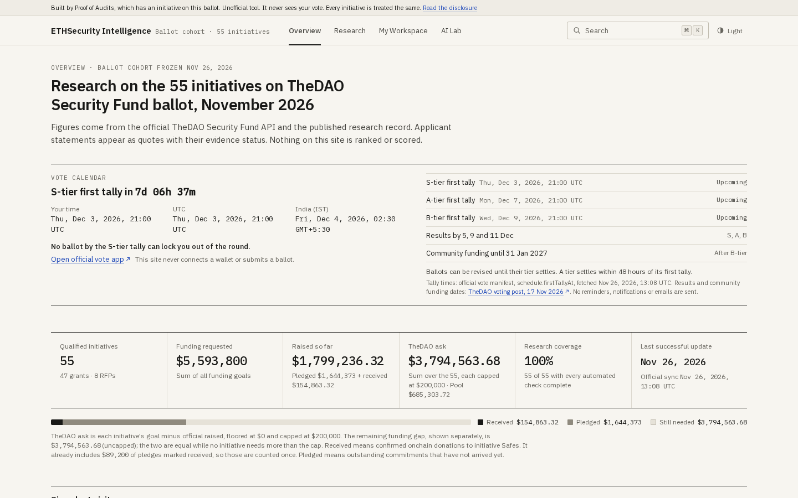
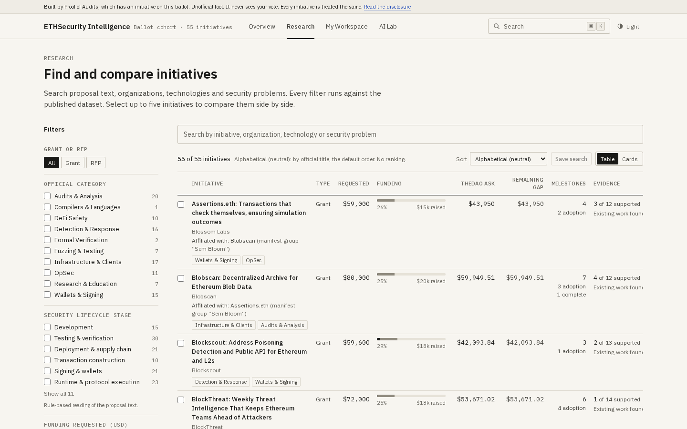
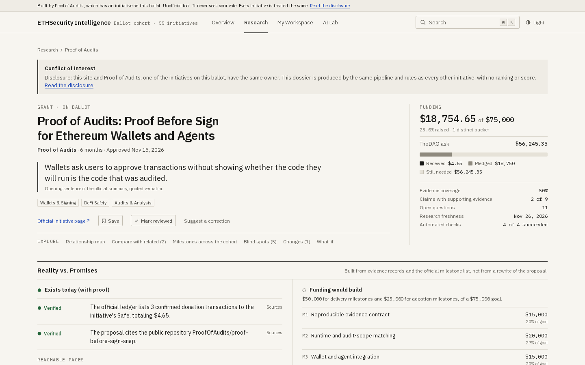
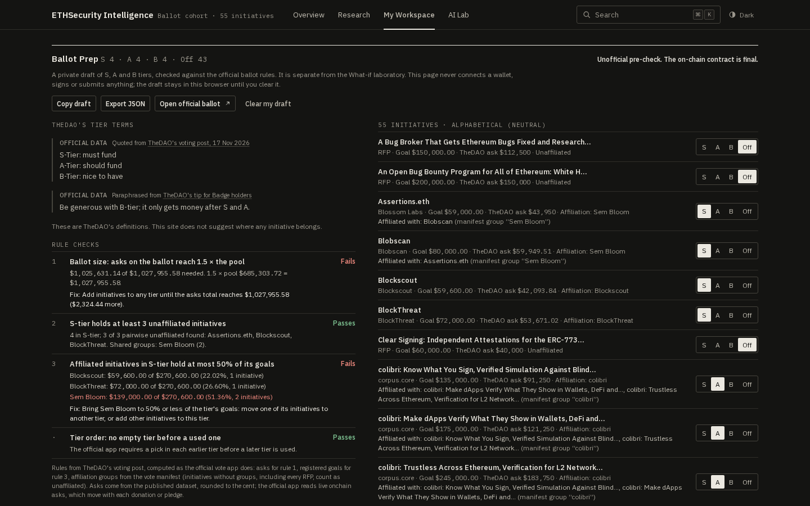
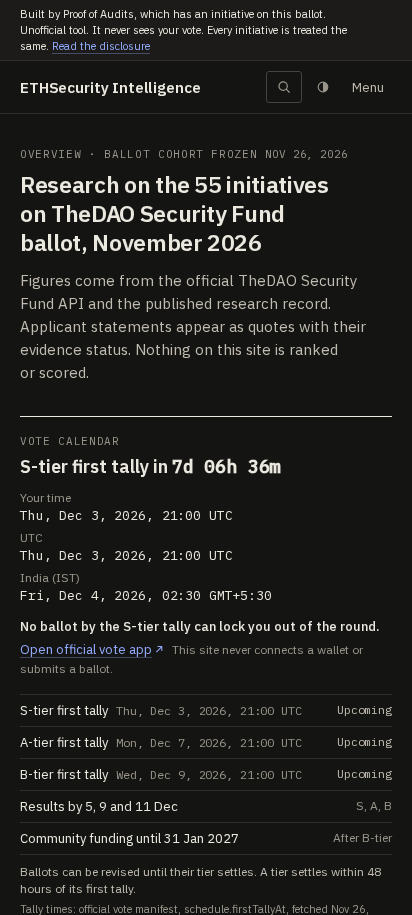

# ETHSecurity Intelligence

Independent research and decision-support platform for the initiatives on the TheDAO Security Fund ballot. It collects the official records, checks applicant statements against public evidence, and lets ETHSecurity badge holders explore, compare and prepare their own ballot.

- **Research only.** The site never advocates for or against an initiative and never tells anyone how to vote. Voting happens only on TheDAO's official platform at [initiatives.thedao.fund/vote](https://initiatives.thedao.fund/vote).
- **Conflict-of-interest disclosure.** This site is built by Proof of Audits, which has an initiative on this ballot. Every page shows a banner saying so. Proof of Audits gets exactly the same templates, wording, research requirements and evidence standards as every other initiative, and automated tests enforce it (see [AGENTS.md](AGENTS.md) and [METHODOLOGY.md](METHODOLOGY.md#equal-treatment)).
- **No ranking.** No scores, stars, ranks or match percentages. Lists default to the order labeled "Alphabetical (neutral)".



## What it does

| Area | Route | What you get |
| --- | --- | --- |
| Overview | `/` | Cohort figures (TheDAO ask first, remaining funding gap separate), the Vote Calendar with the official tally times, changes since your last visit, coverage and recent changes. |
| Research | `/research` | Filter and search all cohort initiatives as a table or as cards; sort options are labeled, the default is alphabetical. |
| Dossier | `/initiatives/[slug]` | Plain-language summary, Reality vs. Promises, funding bar, milestones, claims with evidence status, source inspector, history, corrections. |
| Advanced views | `/research/*` | Compare, relationship graph, security coverage map, blind spots, changes over time, what-if laboratory, Milestone X-Ray, funding relationships, collaboration discovery. |
| My Workspace | `/workspace` | Saved initiatives and notes, May interest you, My affiliations, Ballot Prep with the three official ballot rules. Stored only in your browser. |
| AI Lab | `/lab` | Read-only MCP server instructions, research briefs and generated research skills. |
| Reference | `/methodology`, `/status`, `/corrections`, `/about` | Metric registry, evidence statuses, privacy, data freshness, public corrections changelog, disclosure. |
| API | `/api/v1/*` | Read API over the same intelligence engine, plus correction submission and moderation. |
| MCP | `/api/mcp`, `npm run mcp` | Read-only Model Context Protocol server (Streamable HTTP and stdio). |

The update items in [PROJECT_SPEC.md](PROJECT_SPEC.md) describe the vote features: neutral language rules (Item 1), disclosure and privacy (Item 2), the official vote manifest and TheDAO ask (Item 3), the Vote Calendar (Item 4), Ballot Prep (Item 5), affiliation flags (Item 6) and May interest you (Item 7).

## Quick start

Requirements: Node.js 22 (the package allows 20.18 or later) and npm.

```bash
npm ci
npm run build
npm start            # http://localhost:3000
```

Without `MONGODB_URI` the app reads the checked-in dataset from `data/published/` and stores submitted corrections in `.data/corrections.json`. That mode is meant for development.

For development with hot reload use `npm run dev`.

### Local MongoDB

```bash
npm run db:local                                   # MongoDB 8 on port 27027, data in .data/mongo
MONGODB_URI=mongodb://127.0.0.1:27027 npm run db:setup
MONGODB_URI=mongodb://127.0.0.1:27027 npm run db:load
```

### MongoDB Atlas (free tier)

1. Create a free M0 cluster in MongoDB Atlas. The code uses only CRUD, indexes and `collMod`, all available on M0.
2. Create a database user and add the server's egress IP address under Network Access.
3. Copy `.env.example` to `.env.local` and set `MONGODB_URI` (and `MONGODB_DB`, default `ethsecurity_intelligence`). `.env.local` is ignored by git. Never commit a connection string.
4. Check the connection, then create collections and load the dataset:

```bash
node --env-file=.env.local --import tsx scripts/db-ping.ts
node --env-file=.env.local --import tsx scripts/db-setup.ts
node --env-file=.env.local --import tsx scripts/db-load.ts
```

**Current Atlas status (26 Nov 2026):** not connected. Every attempt from the development sandbox failed at the TLS handshake with `tlsv1 alert internal error ... SSL alert number 80`, which Atlas returns when the client IP is not on the project's Network Access list. `db:setup` and `db:load` have therefore not been run against Atlas; they were tested against MongoDB 8.2.6 through `mongodb-memory-server`. See [docs/test-results.md](docs/test-results.md). If the database is unreachable at runtime, the app falls back to the published dataset in read-only mode and retries after 30 seconds.

## Data pipeline

```bash
npm run ingest        # fetch official records and the vote manifest into data/official (content addressed)
npm run research      # run research jobs (websites, GitHub, milestone artifacts, onchain donations)
npm run publish       # build data/published/dataset.json and run the truth audit; refuses to write on failure
npm run skills:build  # regenerate skills/ from the published dataset
npm run pipeline      # all four in order
```

`npm run publish` re-checks every published figure and quote against the raw official objects (`research/audit.ts`). Publication is blocked if any check fails. `GITHUB_TOKEN` is optional and only raises the GitHub rate limit.

## MCP server

- **Local (stdio):** `npm run mcp`. For an MCP client, use the command `npm` with arguments `run --silent --prefix /path/to/ethsecurity-intelligence mcp`.
- **Remote (Streamable HTTP):** `POST <site>/api/mcp`. Stateless, read-only, request bodies up to 64 KiB.
- **Smoke test:** `npm run mcp:smoke` (stdio) or `npm run mcp:smoke -- --url http://localhost:3000/api/mcp`.

The tools are listed on the AI Lab page and in `lib/mcp/catalog.ts`. Every tool result passes the neutral-language filter.

## Checks

```bash
npm run typecheck
npm run lint
npm test             # Vitest unit and integration tests, including the neutral-language lint and equal-treatment tests
npm run build
npm run test:e2e     # Playwright, desktop 1440x900 and Pixel 7; needs a build first
npm run mcp:smoke
npm run screenshots  # needs a build; writes docs/screenshots
```

CI runs the same steps on every push and pull request ([.github/workflows/ci.yml](.github/workflows/ci.yml)). The latest recorded results are in [docs/test-results.md](docs/test-results.md).

## Deployment

Any Node.js host that runs `next start` works, for example Vercel. Set these environment variables (see `.env.example`): `MONGODB_URI`, `MONGODB_DB`, `MODERATOR_TOKEN`, `RATE_LIMIT_SALT`, `CONTACT_ENCRYPTION_KEY` and `NEXT_PUBLIC_SITE_URL`. Moderation endpoints stay disabled while `MODERATOR_TOKEN` is unset, and private contact fields are rejected while `CONTACT_ENCRYPTION_KEY` is unset. Pages revalidate every 10 minutes.

## Screenshots

| | |
| --- | --- |
|  |  |
|  |  |

All screenshots, at 1440x900 and 412x915 in light and dark, are in [docs/screenshots](docs/screenshots).

## Limitations

- The research cohort was frozen from the first validated ballot snapshot (`data/cohort.json`). Changes in ballot eligibility are flagged, not applied silently.
- Automated research observes what is public: repository metadata, website reachability, onchain receipts. Activity and counts are not measures of security quality.
- "Not found" means the pipeline found no evidence. It is never a negative finding.
- TheDAO ask is computed from the official API at each sync. The vote contract computes its own ask onchain when a ballot is recorded, and the two can differ.
- Ballot Prep is an unofficial pre-check. The official vote app is authoritative.
- The "Find my public profile" lookup is off: no verifiable public directory of badge holders exists (see [METHODOLOGY.md](METHODOLOGY.md#affiliation-flags)).

## Documentation

[PROJECT_SPEC.md](PROJECT_SPEC.md), [METHODOLOGY.md](METHODOLOGY.md), [DATA_DICTIONARY.md](DATA_DICTIONARY.md), [NEUTRAL_LANGUAGE.md](NEUTRAL_LANGUAGE.md), [AGENTS.md](AGENTS.md), [docs/architecture.md](docs/architecture.md), [docs/research-coverage.md](docs/research-coverage.md), [CONTRIBUTING.md](CONTRIBUTING.md), [SECURITY.md](SECURITY.md), [ATTRIBUTION.md](ATTRIBUTION.md).

## License

Software: [MIT](LICENSE). Data: see [ATTRIBUTION.md](ATTRIBUTION.md).
