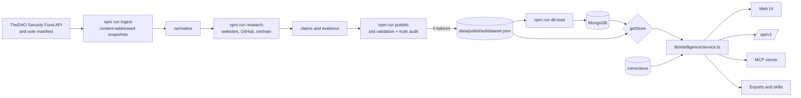

# Architecture

ETHSecurity Intelligence is one Next.js 16 (App Router) application with a TypeScript research pipeline, a MongoDB store with a file fallback, and a read-only MCP server. One intelligence engine serves the web UI, the REST API, the MCP server and exports, so all of them state the same figures.

## Layers

| Layer | Location | Responsibility |
| --- | --- | --- |
| Official client | `lib/official/` | Typed client and zod schemas for TheDAO Security Fund API. |
| Ingestion | `research/ingest.ts` | Fetches the initiative list, initiatives, revisions, ballot list and vote manifest into a content-addressed store (`data/official/objects`, `snapshots`, `revisions`). Validates each snapshot. |
| Normalization | `research/normalize.ts` | Official objects to domain records (`lib/domain/schemas.ts`), integer cents, identity resolution (`lib/domain/identity.ts`), taxonomy (`lib/domain/taxonomy.ts`). |
| Research | `research/collect.ts`, `queue.ts`, `web.ts`, `github.ts`, `onchain.ts` | Bounded-concurrency jobs per initiative and task: websites, GitHub, milestone artifacts, onchain donation receipts. A job reruns when its input hash changes, when it is pending or failed (up to a maximum number of attempts), or when its last success is older than the time-to-live. |
| Claims and evidence | `research/claims.ts`, `research/evidence.ts` | Claim extraction and evidence statuses. |
| Publishing | `research/publish.ts`, `research/audit.ts` | Builds `data/published/dataset.json`, validates it with zod and runs the truth audit. Refuses to write on any failure. |
| Metrics | `lib/metrics/` | Metric registry and integer-cent computation, including TheDAO ask (`ask.ts`). |
| Vote features | `lib/vote/` | Manifest alignment, Vote Calendar, Ballot Prep rules, affiliation matching, May interest you, badge directory status. Pure and browser-safe. |
| Store | `lib/db/` | `IntelligenceStore` contract with `MongoStore` and `FileStore`; validators and indexes in `setup.ts`. |
| Intelligence engine | `lib/intelligence/` | `loadIntelligence()` (dataset plus accepted corrections) and `service.ts` (summaries, filters, dossiers, compare, coverage, graph, changes, simulations, exports, metrics). Every result is wrapped in an envelope with sources, freshness, methodology and limitations. |
| Corrections | `lib/corrections/` | Submission schema, spam checks, contact encryption, moderation state machine, application of accepted corrections. |
| Wording | `lib/neutralLanguage.ts`, `lib/neutralLanguageLint.ts`, `lib/disclosure.ts` | Neutral-language rules, output filter, source labels, disclosure texts. |
| Web UI | `app/`, `components/` | Server-rendered pages (regenerated from the published dataset at most every 10 minutes); browser-only workspace in `components/workspace/`. The Overview, My Workspace, the data-freshness page and `/api/v1/vote-manifest` also apply the live pool and schedule from `lib/vote/live.ts`: one validated manifest read per server every 12 minutes at most, never per user. Everything else changes only with a new publish. |
| REST API | `app/api/v1/` | Read endpoints over the engine; correction submission and moderation. |
| MCP | `mcp/`, `app/api/mcp/`, `lib/mcp/catalog.ts` | Read-only MCP server over stdio and stateless Streamable HTTP. |
| AI Lab and skills | `lib/skills/`, `scripts/build-skills.ts`, `skills/` | Research briefs built in the browser and generated research skills. |

## Data flow

Nothing calls TheDAO's API per user request. Pages, the API and the MCP server read the published dataset through the store.

## Store fallback

`getStore()` in `lib/db/index.ts` returns a `MongoStore` when `MONGODB_URI` is set and the database answers. If the connection fails, it returns a read-only `FileStore` over `data/published/` and retries MongoDB after 30 seconds. The error is logged with the host redacted. Without `MONGODB_URI`, `FileStore` is used directly and stores corrections in `.data/corrections.json` (development only). The status page shows which store is active.

In MongoDB, `meta` and `vote` live in the `current` document of `dataset_meta`, so the dataset version pointer and the vote manifest move together. `loadDataset` upserts every record, removes records that are no longer in the dataset only after all upserts succeed, then moves the pointer.

## Corrections propagation

1. A correction is submitted through the dossier form (`POST /api/v1/corrections`), validated, rate limited by a keyed hash of the network address and stored with state `submitted`.
2. A moderator moves it through the allowed transitions (`POST /api/v1/moderation/corrections`, bearer token).
3. `loadIntelligence()` applies accepted and partially accepted corrections to the claims on every load: the status or assertion changes, a limitation can be added, and the claim history gets an entry with the correction id.
4. The change appears in the public changelog (`/corrections`), in the claim history, in the change log as `correction_published`, and in the API and MCP results, because all of them read through the engine.

## MCP server

`mcp/server.ts` builds a read-only server with the tools listed in `lib/mcp/catalog.ts`. Every tool result is wrapped by the neutral-language envelope: our notes and limitations pass the output filter, and source records pass through verbatim with their status. Transports:

- stdio: `npm run mcp` (`mcp/stdio.ts`).
- Streamable HTTP: `app/api/mcp/route.ts`, stateless (a new server and transport per request), JSON responses, bodies up to 64 KiB, open CORS because the data is public.

`npm run mcp:smoke` connects with the official SDK client, lists the tools and calls each with valid and invalid input.

## Browser-only state

My Workspace, AI Lab templates and the theme live in local storage (`esi.workspace`, `esi.lab.templates`, `esi.theme`). Ballot Prep, affiliation matching and May interest you run in the browser on the published dataset and never send requests with personal input. The app never connects a wallet. See the Privacy section of [METHODOLOGY.md](../METHODOLOGY.md#privacy).

## Testing

- Vitest unit and integration tests (`tests/unit`, `tests/integration`), with MongoDB 8 through `mongodb-memory-server`. They include the neutral-language lint, the equal-treatment scan and parity test, privacy checks and the truth audit.
- Playwright end-to-end tests (`tests/e2e`) on a desktop (1440x900) and a mobile (Pixel 7) project, including accessibility checks with axe.
- CI: [.github/workflows/ci.yml](../.github/workflows/ci.yml).
